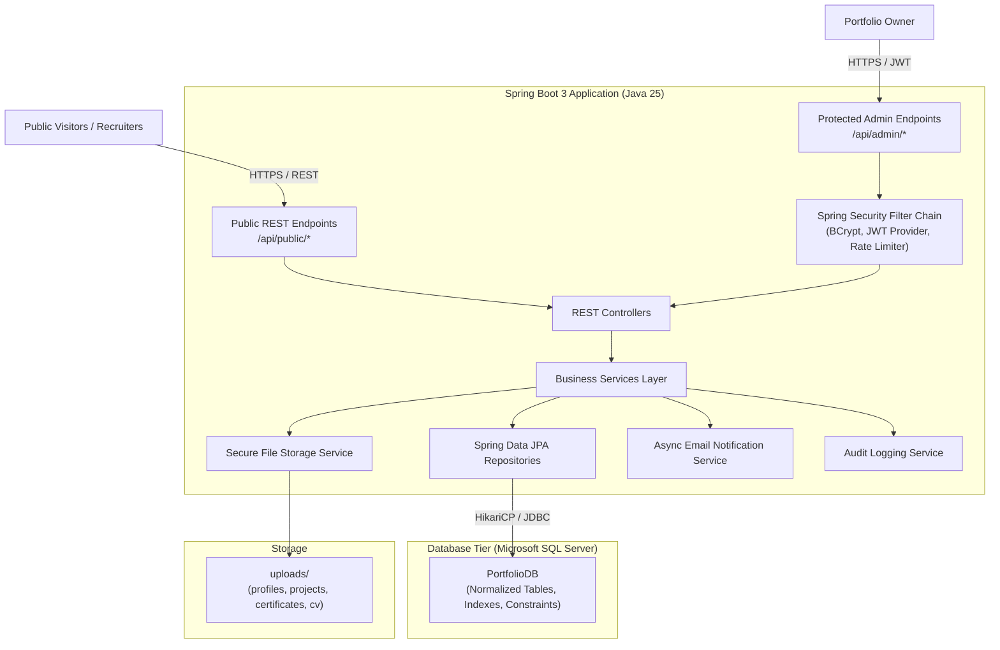

# System Architecture Documentation

## 1. Architectural Overview

The **Personal Portfolio Management System** is architected as an enterprise-grade, full-stack decoupled application consisting of:
1. **Frontend Presentation Tier**: Semantic HTML5, CSS3 (Dark Navy / Electric Blue theme), and modern ES6 JavaScript leveraging Fetch API.
2. **Backend Application Tier**: Java 25, Spring Boot 3.5.x, Spring Web, Spring Security, Spring Data JPA / Hibernate, Jakarta Validation, and Spring Boot Actuator.
3. **Database Tier**: Microsoft SQL Server (`PortfolioDB`) accessed via the Microsoft JDBC Driver (`mssql-jdbc`) with connection pooling (HikariCP).

---

## 2. Layered Architecture Design

The backend strictly follows the **Separation of Concerns (SoC)** and **Single Responsibility Principle (SRP)**:

### 2.1. Controllers (`com.portfolio.controller`)
- Serve as the HTTP interface for incoming client requests.
- Expose RESTful endpoints adhering to standard HTTP methods: `GET` (read), `POST` (create), `PUT` (update), `PATCH` (partial update/approval), `DELETE` (remove).
- Handle request binding and trigger Jakarta Bean Validation (`@Valid`).
- Return uniform HTTP response envelopes (`ApiResponse<T>`).
- Completely isolated from database queries and persistence details.

### 2.2. Services (`com.portfolio.service`)
- Enforce core business rules, transactional boundaries (`@Transactional`), and workflow orchestration.
- Prevent exposure of JPA entities to presentation layers by transforming between Database Entities and Data Transfer Objects (DTOs).
- Coordinate audit trail generation, login attempt rate limiting, and asynchronous notifications.

### 2.3. Data Transfer Objects (`com.portfolio.dto`)
- Enforce strict API contracts.
- Encapsulate validation constraints (`@NotBlank`, `@Size`, `@Email`, `@Min`, `@Max`).
- Prevent JSON infinite recursions and accidental exposure of sensitive entity columns (e.g. `PasswordHash`, `LockoutUntil`).

### 2.4. Data Access Layer (`com.portfolio.repository`)
- Spring Data JPA repositories extending `JpaRepository`.
- Provide type-safe queries, derived queries, and automated pagination/sorting.

### 2.5. Security & Authentication (`com.portfolio.security`)
- Stateless authentication using HMAC-SHA256 JSON Web Tokens (JJWT 0.12.x).
- BCrypt password hashing with cost factor 12.
- In-memory thread-safe login rate limiter with 15-minute lockout after 5 consecutive failures.
- Role-based authorization: `ROLE_ADMIN` required for all `/api/admin/**` and actuator endpoints.
- One-time first-admin provisioning mechanism that automatically and permanently locks once the first administrator account is created.
