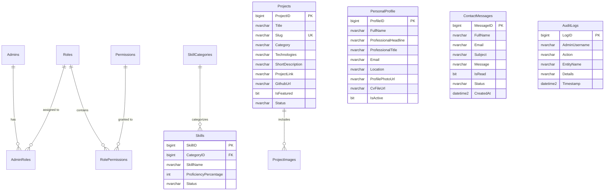

# Microsoft SQL Server Database Design

## 1. Database Specification

- **DBMS**: Microsoft SQL Server (2019, 2022, 2025, Azure SQL, or SQL Server Express)
- **Database Name**: `PortfolioDB`
- **Default Port**: `1433`
- **Schema**: `dbo`
- **Dialect**: `org.hibernate.dialect.SQLServerDialect`
- **Driver**: `com.microsoft.sqlserver.jdbc.SQLServerDriver`

---

## 2. Empty Production Database Mandate

> [!IMPORTANT]
> **Zero Portfolio Content Records on Deployment**
> In strict accordance with production standards, the database schema initialization (`schema.sql` and `V1__initial_schema.sql`) creates all 22 required normalized tables, unique constraints, foreign keys, and non-clustered performance indexes, but inserts **ZERO** sample portfolio content records.
> 
> Real data is populated exclusively through the authenticated Administrator Dashboard or secure administrative provisioning. When no records exist in a table, the system returns an empty list and genuine database counts (`0`), and the frontend displays clear empty-state notifications without errors.

---

## 3. Entity-Relationship Model

---

## 4. Normalized Table Structures

1. **`Roles`**: System roles (`ADMIN`, `EDITOR`).
2. **`Permissions`**: Granular security capabilities.
3. **`Admins`**: Authenticated administrative accounts with BCrypt password hashes, failed login counters, lockout timestamps, and audit references.
4. **`AdminRoles`**: Many-to-many junction table between `Admins` and `Roles`.
5. **`RolePermissions`**: Many-to-many junction table between `Roles` and `Permissions`.
6. **`PersonalProfile`**: Biography summary, headline, title, contact details, profile photo path, and CV document URL.
7. **`AboutInformation`**: Extended biographical copy, multi-paragraph narrative, years of experience, and statistics.
8. **`SkillCategories`**: Categories (e.g. *Web Development*, *Programming Languages*, *Database Architecture*, *Networking*).
9. **`Skills`**: Specific technical skills with percentage proficiency ratings (0–100%) and display order.
10. **`Services`**: Professional freelance and software offerings.
11. **`Projects`**: Featured and standard portfolio projects with descriptions, technology tags, live demo links, and GitHub links.
12. **`ProjectImages`**: Additional screenshots and gallery assets attached to projects.
13. **`Education`**: Formal academic institutions, diplomas, degrees, dates, and coursework notes.
14. **`Experience`**: Work history, company name, roles, responsibilities, and technologies used.
15. **`Certificates`**: Professional certifications, issuing authorities, credential verification URLs, and certificate files.
16. **`Achievements`**: Honors, competitive programming achievements, awards, and hackathons.
17. **`Testimonials`**: Recommendations and reviews with approval workflow states (`PENDING`, `APPROVED`, `REJECTED`, `ARCHIVED`).
18. **`ContactMessages`**: Visitor inquiries with read status, client IP address, and submission timestamps.
19. **`SocialLinks`**: Configurable professional social platform links (GitHub, LinkedIn, Twitter, etc.).
20. **`WebsiteSettings`**: Dynamic global site configurations and metadata.
21. **`AuditLogs`**: Complete immutable audit trail of all security, authentication, and content mutations.
22. **`UploadedFiles`**: File upload metadata, MIME types, file sizes, storage paths, and uploaded-by auditing.

---

## 5. Performance Optimization & Indexing

Non-clustered indexes are defined on high-frequency query columns:
- `IX_Admins_Username` and `IX_Admins_Email`: Fast authentication lookup.
- `IX_Projects_Slug`: O(1) slug resolution.
- `IX_Projects_Status` and `IX_Projects_Category`: Filtered public catalog queries.
- `IX_Skills_Category` and `IX_Skills_Status`: Fast category grouping.
- `IX_ContactMessages_Status` and `IX_ContactMessages_IsRead`: Fast unread badge counting.
- `IX_AuditLogs_Timestamp`: Descending order chronological audit queries.
